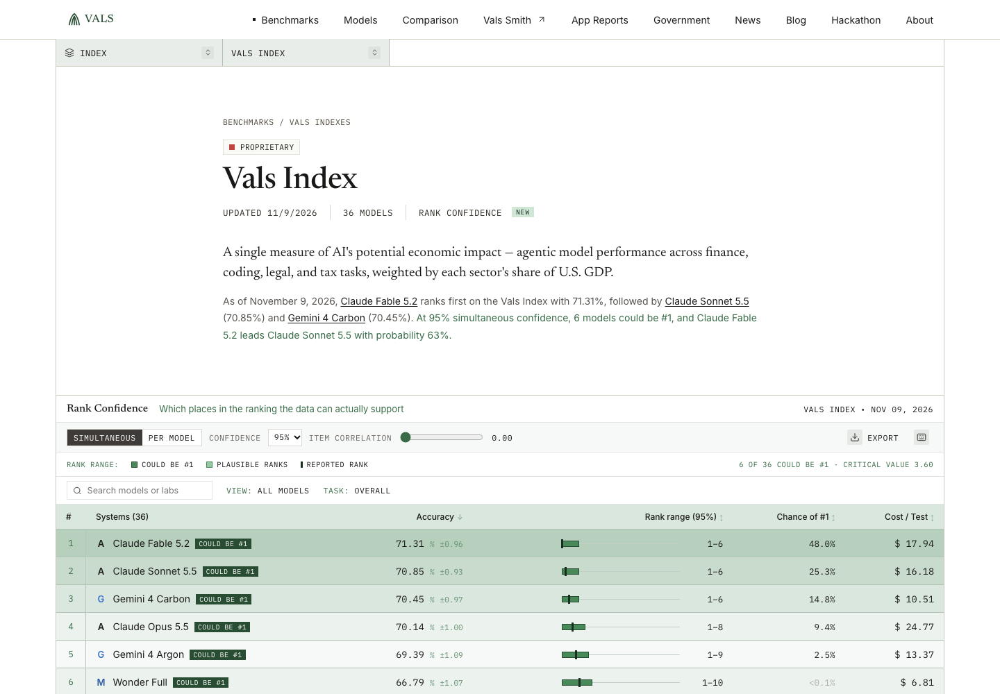

# Rank Confidence for Vals leaderboards

**Live demo:** https://mohith26.github.io/vals-ai-rank-confidence/ · Unofficial concept demo by Mohith Gajjela. Not affiliated with Vals AI. Public data from vals.ai leaderboard pages, fetched Nov 11 2026.

Vals already publishes a standard error next to every score, and its methodology page explains exactly how they are computed. The leaderboards still rank models 1, 2, 3 by point estimate. **Rank Confidence** turns those published standard errors into what a reader actually wants to know: which ranks the data supports. Each model gets a simultaneous 95% rank range, the set of models that could be #1, its chance of being first, a head-to-head view against every other model, and how much more evaluation it would take to separate two neighbors. For Vals' 3-run benchmarks it also fixes a quiet problem: a standard error estimated from 3 runs has 2 degrees of freedom and can come out as exactly 0, so it moderates them across models before ranking.

## Results (all 58 public leaderboards with standard errors, `results/results.json`)

| Leaderboard | Models | Could be #1 at 95% (simultaneous) | Notes |
|---|---|---|---|
| Vals Index | 36 | **6** (Claude Fable 5.2, Claude Sonnet 5.5, Gemini 4 Carbon, Claude Opus 5.5, Gemini 4 Argon, Wonder Full) | #1 vs #2: 0.455-pt gap, P(#1 really ahead) = 63%; separating them needs ~67× the test items |
| Vals Index, per-model intervals | 36 | 5 | leader's rank range 1–5 (1–6 simultaneous) |
| Vals Index, item correlation 0.5 | 36 | 5 | models share test items, so 0 correlation is the conservative default |
| Terminal-Bench 4.0 (3 runs) | 63 | **13** with moderated SEs, 37 with raw 3-run SEs | 6 models report an SE of exactly 0 |

Across the 58 leaderboards, 53 have more than one model that could be #1.

## How it works

1. **Data.** `scripts/scrape.py` reads each public `vals.ai/benchmarks/<slug>` page's embedded leaderboard data (accuracy, stderr, cost per test, latency for the Overall task). `scripts/build_data.py` writes the committed snapshot `data/vals.json` (58 leaderboards, model names and labs as shown on the pages).
2. **Moderated standard errors (3-run benchmarks).** Terminal-Bench, Finance Agent v2 and BioMysteryBench report the SE over 3 runs. With 2 degrees of freedom an SE is very noisy (6 of 63 Terminal-Bench 4.0 models show 0). Following limma's empirical Bayes (Smyth 2004), variances are scaled by p(1−p), a scaled inverse-χ² prior is fit to all models by the method of moments (digamma/trigamma), and each SE is shrunk toward it; the result has d0 + 2 degrees of freedom. On Terminal-Bench 4.0 the spread of SEs is no larger than chance (d0 = ∞), so the best estimate is one pooled scaled SE. `src/ranks.js: moderateSE`
3. **Rank intervals.** Simultaneous confidence sets for ranks (Mogstad, Romano, Shaikh and Wilhelm, *Inference for Ranks*, REStud 2024): a parametric bootstrap of the largest studentized pairwise difference gives a critical value c; model j's rank lies between 1 + #(models significantly above it) and p − #(models significantly below it). A stepwise (Romano-Wolf) refinement re-computes c over the still-undecided pairs. Per-model intervals use each model's own max over its pairs. Student-t tails are used when SEs come from few runs. `rankIntervals`
4. **Could be #1** = models whose interval reaches 1; it contains the true leader with 95% confidence. **Chance of #1** is a simpler Bayesian read (redraw scores within their SEs) and is labeled as such.
5. **What would settle it.** For neighbors, the factor by which the sample (test items, or runs for 3-run boards) must grow to detect the observed gap at 95% with 80% power: ((z₀.₉₇₅ + z₀.₈)·SE_diff/gap)².
6. **Item correlation.** Models answer the same items, so their errors are positively correlated and the SE of a difference is smaller than √(SE₁² + SE₂²). The slider shows the effect; Vals has the item-level data to compute it exactly per pair.

App: benchmark switcher (all 58 boards), simultaneous / per-model toggle, 90/95/99%, correlation slider, moderated-SE toggle, sortable leaderboard with rank-range bars, search, head-to-head drawer per model, CSV/JSON export, deep links (`#/benchmarks/terminal-bench-4?mode=marginal&rho=0.30&model=...`), settings saved in `localStorage`, keyboard shortcuts (`/`, `j`/`k`, `s`, `[`/`]`, `e`, `?`, `Esc`), loading and error states.

## Tests

`node --test test/ranks.test.mjs`: 14 tests. Closed-form quantiles and polygamma; exact ranks for separated models and full ranges for identical ones; **simultaneous coverage ≥ 95% over 150 random leaderboards (randomized)**; per-model ⊆ simultaneous and reported rank inside its interval; monotone in correlation; the could-be-#1 set contains the true best (randomized); zero SEs repaired; **moderation recovers the prior df and cuts log-variance error by more than 40% vs raw 3-run SEs (randomized)**; pairwise and planner closed forms; frontier; chance-of-#1 sums to 1; data snapshot matches the pages; headline numbers equal `results/results.json`; CSV escaping. A GitHub Actions workflow is in `ci/test.yml` (move it to `.github/workflows/` to activate; my push token lacked the workflow scope).

## Limitations (honest)

- I only see per-model SEs, not item-level results, so differences use independent errors (correlation 0), which is conservative: real ties are fewer. With item-level data Vals can use paired differences.
- Normal approximation for single-run boards (fine for hundreds of items); Student-t only where SEs come from 3 runs. Composite indexes use the propagated SE Vals publishes.
- Rank intervals are only as good as the reported SEs; Vals notes they exclude prompt, seed and deployment variability, so real uncertainty is larger.
- Moderation assumes 3-run variances share one prior after scaling by p(1−p); boards with mixed run counts would need per-model df.
- Data is a snapshot from Nov 11 2026; names for one model id without a public page link use the label printed on the Vals Index chart.

## Prior art and what is new

Rank uncertainty has precedent: LMArena shows rank upper bounds from Bradley-Terry bootstraps, Mogstad et al. give the inference method, limma's moderated variances are standard in genomics, and Evan Miller's "Adding Error Bars to Evals" (which Vals cites) recommends error bars and paired tests. Vals already shows standard errors and ±1 SE bars, but its leaderboards rank strictly by point estimate and show no rank ranges, ties or separation plans, and its 3-run SEs are used as-is. I did not find any eval leaderboard that combines simultaneous rank intervals with moderated few-run SEs and a separation planner.

Design tokens (colors, spacing, components) come from vals.ai's production stylesheet and screenshots of the live page. Söhne, Martina Plantijn and Berkeley Mono are licensed fonts, so the demo uses Inter, Newsreader and IBM Plex Mono.
